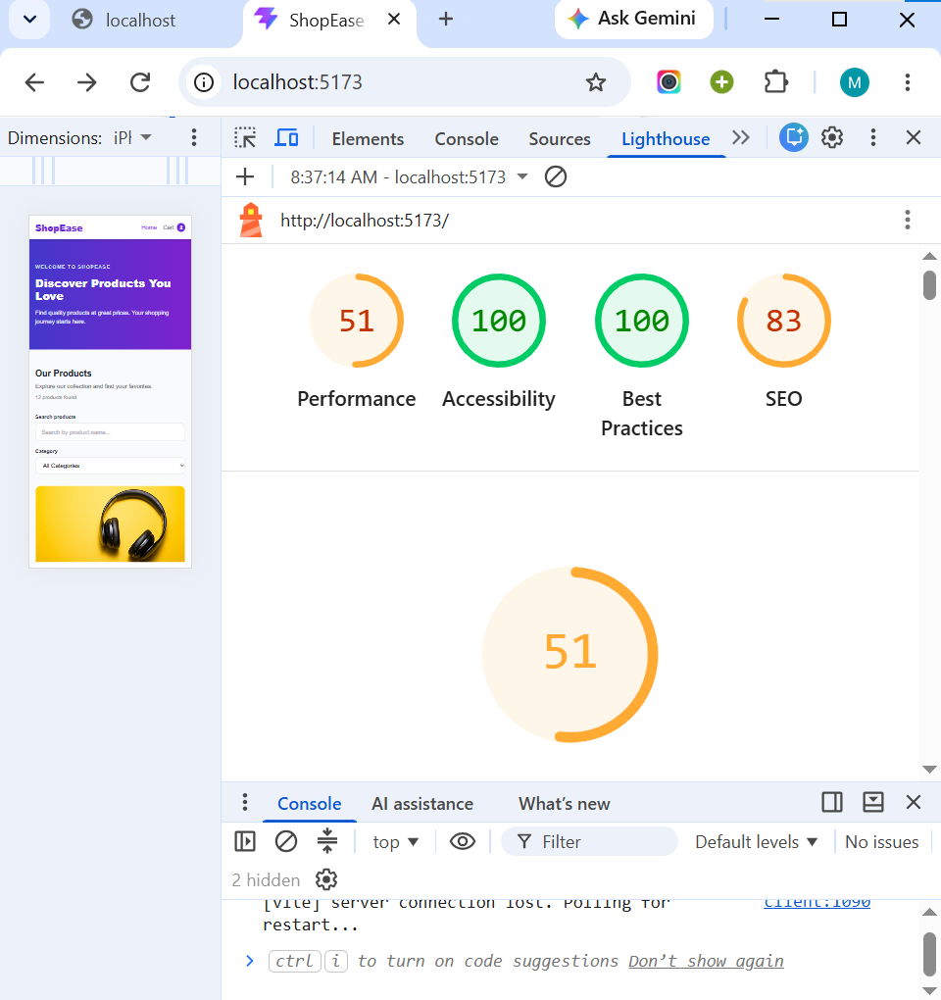
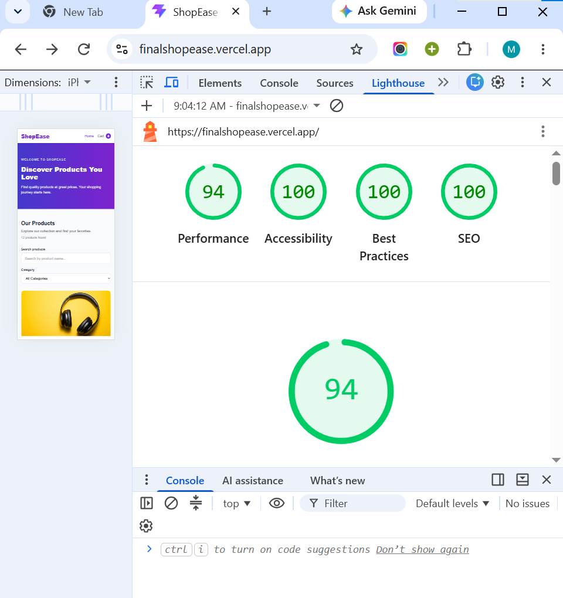

# ShopEase – Online Shopping Marketplace

ShopEase is a responsive online shopping marketplace built with React and Tailwind CSS. Users can explore products, search and filter by category, view product details, add products to their cart, and complete a checkout form.

## Homepage Preview


## Live Demo

- **Live Website:** https://finalshopease.vercel.app/
- **GitHub Repository:** https://github.com/sinbo19/finalshopease

## Technologies Used

- React
- JavaScript
- Tailwind CSS
- React Router DOM
- Vite
- Git and GitHub
- Vercel

## Features

- Responsive product catalogue with 12 products.
- Search products by name.
- Filter products by category.
- Dynamic product detail pages.
- Add products to cart.
- Increase and decrease product quantities.
- Remove products from cart.
- Cart data saved using localStorage.
- Checkout form with input validation.
- Empty cart and not-found pages.
- Responsive navigation.
- Keyboard accessibility and visible focus indicators.

## Project Structure

```text
src/
├── components/
│   ├── Navbar.jsx
│   └── ProductCard.jsx
├── context/
│   └── CartContext.jsx
├── data/
│   └── products.js
├── pages/
│   ├── Home.jsx
│   ├── ProductDetails.jsx
│   ├── Cart.jsx
│   ├── Checkout.jsx
│   └── NotFound.jsx
├── reducers/
│   └── cartReducer.js
├── App.jsx
└── main.jsx

screenshots/
├── ShopEase-Homepage.png
├── ShopEase-Lighthouse-Before-Fixes.png
└── ShopEase-Lighthouse-Final-Results.png
```

## Installation and Setup

### 1. Clone the repository

```bash
git clone https://github.com/sinbo19/finalshopease.git
```

### 2. Open the project folder

```bash
cd finalshopease
```

### 3. Install dependencies

```bash
npm install
```

### 4. Start the development server

```bash
npm run dev
```

### 5. Build for production

```bash
npm run build
```

## Lighthouse Audit

Lighthouse was used to test the deployed website on mobile.

| Category       | Before Fixes | After Fixes |
| -------------- | -----------: | ----------: |
| Performance    |           51 |          94 |
| Accessibility  |          100 |         100 |
| Best Practices |          100 |         100 |
| SEO            |           83 |         100 |

### Improvements Made

- Improved production performance.
- Added meaningful image alt text.
- Added accessible form labels and validation messages.
- Added keyboard navigation and visible focus indicators.
- Added page metadata and SEO description.
- Improved responsive layouts.

### Lighthouse Screenshots

**Before Fixes**



**After Fixes**



## Limitations and Future Improvements

- Add a backend and database to store products and orders.
- Add user registration and login.
- Integrate a secure payment system.
- Add an administrator dashboard for managing products.

## Author

Developed as an individual frontend development project using React and Tailwind CSS.
